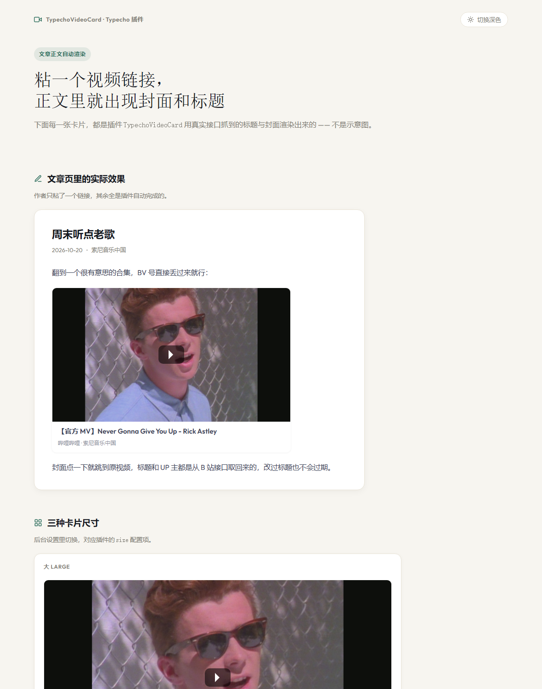

# TypechoVideoCard · 视频卡片

在文章里粘贴视频链接，自动渲染成带封面和标题的卡片，点击封面跳转原视频。

支持 **哔哩哔哩**、**YouTube**、**Vimeo**。视频信息只抓一次，缓存在数据库里，之后不再请求第三方接口。



## 特性

- 纯后端渲染，不用前端脚本，静态化缓存也能正常显示
- 标题、封面、UP 主自动抓取并入库，抓不到时保留原链接，不影响发文章
- 三种卡片尺寸：封面居上、居中、紧凑
- 列表页可开可关，RSS 订阅源始终不渲染卡片
- Typecho 1.2 / 1.3 通用

## 安装

把 `TypechoVideoCard` 目录放到 Typecho 的 `usr/plugins/` 下：

```
usr/plugins/TypechoVideoCard/Plugin.php
```

然后进后台「控制台 → 插件」，找到「视频卡片」点**启用**。启用时会自动建一张缓存表 `typecho_videocard`。

## 用法

正文里正常粘贴视频链接就行，三种写法都认（下面用占位符，实际换成你的视频地址）：

```markdown
https://www.bilibili.com/video/BVxxxxxxxxxx

https://youtu.be/xxxxxxxxxxx

https://www.youtube.com/watch?v=xxxxxxxxxxx
```

Typecho 的编辑器会把裸链接变成超链接，插件识别后换成卡片：

- 哔哩哔哩：`bilibili.com/video/BVxxxx`、`bilibili.com/video/av123`、`b23.tv` 短链
- YouTube：`watch?v=`、`youtu.be/`、`/embed/`、`/shorts/`、`/live/`
- Vimeo：`vimeo.com/123`、`player.vimeo.com/video/123`

链接写进代码块（`<pre>` / `<code>`）不会被处理。

## 设置

「控制台 → 插件 → 视频卡片 → 设置」：

| 设置 | 说明 |
|---|---|
| 总开关 | 关掉后完全不处理正文 |
| 生效范围 | 仅文章页（默认）／所有页面。所有页面＝首页、归档页、分类页等列表页也会出卡片，但 **RSS 订阅源始终不渲染卡片**（链接照常保留） |
| 卡片尺寸 | 大 / 中 / 紧凑（紧凑为左图右标题） |
| 显示标题 | 关掉只留封面 |
| 支持的平台 | 勾选要启用的平台 |

## 缓存

- 标题和封面存在 `typecho_videocard` 表，键是 `平台:视频ID`。
- 保存文章时会顺手预抓一次视频信息，前台打开文章不用等接口。
- 抓不到信息（接口挂了、视频不存在、没装 curl 扩展）时**保留原链接**，不影响发文章。
- 视频改了标题想更新？删掉 `typecho_videocard` 表里对应的行即可，下次访问会重新抓。

禁用插件不会删缓存表，确认不要了可以自己 `DROP TABLE typecho_videocard`。

## 兼容性

- Typecho **1.2.x** 和 **1.3.x** 都能用（钩子注册和回调签名两边一致）。
- PHP 7.2+。
- 需要服务器支持 cURL（没有的话自动降级为普通链接）。

## 已知限制

- 只认上面列出的平台和链接格式。腾讯视频、爱奇艺、优酷、抖音没有公开的封面/标题接口，暂不支持。
- 封面图来自平台 CDN，个别站点的防盗链可能让图裂开（已加 `referrerpolicy="no-referrer"` 缓解）。
- 卡片会进入文章的 `description` 元信息和摘要里，这是 Typecho 的内容过滤机制决定的。

## 效果预览

`preview.html` 是用真实接口抓到的数据渲染出来的效果页（含三种尺寸对比、替换前后对比、深色模式），双击用浏览器打开即可。

## 关于 B 站取数

B 站的接口对机房 IP 有风控（返回 412），而且是概率性的——同样的请求有时成功有时失败。所以插件用了两条链路：

1. **优先** `x/web-interface/view` 接口，一次拿到标题、封面和 UP 主；
2. **失败时**改走「`x/player/pagelist` 取标题 → `x/web-interface/search/type` 按 BV 号精确匹配封面」。

每个请求最多重试 3 次（间隔 0.3~0.6 秒）。如果这台服务器所在机房被 B 站风控得很厉害，首次渲染可能会慢几秒；标题和封面抓到后会存进缓存表，之后不再请求。

YouTube 走官方 oEmbed 接口，不受影响。

## 仓库结构

```
TypechoVideoCard/
├── Plugin.php        插件主文件（唯一必需文件）
├── preview.html      效果预览页（生成物）
├── preview.png       README 配图
└── tests/            自测脚本，不参与运行
```

发布时只需要 `Plugin.php`，进 `usr/plugins/TypechoVideoCard/` 即可。

## 自测

`tests/run.php` 是纯逻辑测试（不联网），`tests/online.php` 会真的去调平台接口：

```bash
php tests/run.php
php -d extension=php_curl.dll tests/online.php
```

## 许可

MIT

## 作者

[Sleet](https://github.com/Sleet51337)
